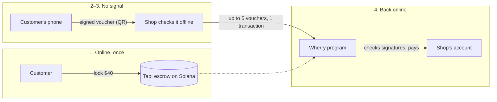

# Wherry

**The ferry for your money when the network's gone.** Pay offline with money that is already locked on Solana, so the shop knows it will be paid.

- Live app: https://wherry-pay.vercel.app (Solana devnet; "test dollars" are a devnet token, not money)
- Demo video: (link added at submission)
- Built solo for the MLH Solana Hackathon, Nov 6–8, 2026

## What it does

When the network goes down, card and phone payments stop, and small shops lose the sale. 2.2 billion people were still offline in 2025 ([ITU, Facts and Figures 2025](https://www.itu.int/en/mediacentre/Pages/PR-2025-11-17-Facts-and-Figures.aspx)). On April 28, 2025, Spain and Portugal lost power, and in-person card payments fell 55% ([Banco de España](https://www.bde.es/wbe/es/noticias-eventos/blog/como-pagamos-cuando-todo-se-apaga-la-experiencia-del-apagon-en-espana.html)).

With Wherry, a customer locks money in an escrow account on Solana while they still have a signal. Later, with no signal at all, their phone signs small vouchers, and the shop checks each one on the spot without a network. When the shop is back online, it collects from the escrow in about a second.

It is for places like Amara's coffee and phone-credit kiosk in a Nairobi market, where the signal drops every day, and for travellers stranded when a storm or landslide takes the towers down.

## How it works

One payment, start to finish:

1. **Lock a tab (online, once).** The customer locks test dollars, say $40, in a *tab*: an escrow account owned by the Wherry program. The tab is tied to a signing key that lives only on their phone.
2. **The phone signs a ferry ticket (offline).** To pay $3, the phone signs a 172-byte voucher: this tab, this shop, this amount, a serial number, an expiry and a random nonce. The phone shows it as a ticket with a QR code.
3. **The shop checks it (offline).** The shop scans the QR and checks the signature, how much is left in the tab (from its last sync), the customer's public payment record and its own risk limits. The signature check takes under 1 ms. An AI model on the shop's own device can add a caution.
4. **The shop collects (back online).** The shop sends up to five vouchers in one transaction. The program checks every signature onchain and pays the shop from the escrow.



Other offline payment projects on Solana sign a whole transaction offline and broadcast it later. Until it lands, the payer can still empty the account, so the shop holds a promise. A Wherry voucher is backed by money that is already locked, so the shop holds a claim on real funds.

## Try it in 2 minutes

Laptop only, one browser, two windows. Everything runs on devnet.

1. **Window A:** open https://wherry-pay.vercel.app/app and go to **1 Owner**. Click "No wallet? Use a test wallet in this browser (devnet only)", then **Get $50 test dollars**. That is the faucet: a fixed $50 of devnet test dollars, up to 3 times per address.
2. **Window B:** open https://wherry-pay.vercel.app/app/phone. It says "Pair this phone". Click **Copy code**.
3. **Window A (Owner):** paste the code under "Pair your phone", enter 40, and click **Lock $40.00 in a tab**. Wait for the Explorer link.
4. **Window A:** go to **3 Shop**. Under the shop's sticker, click **Copy code**.
5. **Window B (Phone):** once it shows your $40 tab, you can turn off Wi-Fi; paying needs no network. Paste the shop code under "Pay a shop", enter 3, and click **Pay**. The phone shows a ticket. Click **Copy voucher code**.
6. **Window A (Shop):** paste the voucher under "Accept a voucher". You will see "Signature valid · checked offline". Click **Accept $3.00**. Turn Wi-Fi back on and click **Settle 1 voucher**. The ticket crosses to the far bank with its confirm time and an Explorer link.

Optional: paste the same voucher again. The shop declines it, and the program would reject it too.

## Methodology

**Research.** I started from problems, not from tech. I ranked ten money problems by how many people they hit, how much Solana's one-second, sub-cent settlement changes the outcome, and whether I could show it working on devnet in two minutes. Offline payments came first: 2.2 billion people offline, a measured 55% drop in card payments in a real blackout, and a demo anyone can follow.

**Idea selection.** I rejected:
- Invoice financing: many hackathon clones already exist, and Solana changes the cost more than the outcome.
- Savings circles and merchant card fees: crowded, and judges have seen them.
- Aid payouts and gig payouts: good problems, but the aid case fits inside offline payments (an aid group can pre-fund tabs before storm season).

Then I looked at prior offline projects. Every Solana one I found (anon0mesh, MeshT, Zypp, OfflineSolanaPay) relays a pre-signed transaction to whoever reconnects first. That does not stop the payer from spending the money first. Cashu-style ecash moves tokens offline but makes the receiver trust a mint. I chose vouchers backed by an onchain escrow: the shop's worst case is known before it hands over the goods.

**Design.** I wrote the account layout, the voucher bytes and the threat model before the UI. I drew the brand (warm chart paper, river ink, a red barge sail) and a mascot, Doggett, a small wherry boat. Vouchers look like ferry tickets, and the shop screen shows them crossing a river when they settle.

**Build.** One Anchor program, a Next.js app with three roles (Owner, Phone, Shop), and a typed client generated from the program with Codama. A service worker keeps the phone and shop screens working offline after the first visit.

**Testing.** 36 TypeScript tests run the real program in LiteSVM (a fast local Solana VM), including seeded property tests that try random overspends and replays. Then I ran every milestone on devnet from the real UI and recorded the signatures and timings below.

### Decisions and why

| Decision | Why |
|---|---|
| Vouchers backed by an escrow tab | The money exists before the sale. A relayed transaction can be beaten by the payer emptying the account first. |
| Ed25519 precompile + instructions sysvar | Solana has a built-in program that checks Ed25519 signatures cheaply. My program reads the instruction right before it (through the instructions sysvar, a read-only list of the transaction's instructions) and requires it to have checked exactly this voucher, with this tab's phone key. |
| Sequential tab ids | Tab number N must equal the number of tabs the owner has opened. A closed tab's address never comes back, so an old voucher can't be replayed on a new tab. |
| A 1,024-bit bitmap per tab | Each voucher serial flips one bit when settled. Replay protection costs 128 bytes per tab and no extra accounts. |
| Shortfall instead of failure | If a customer overspends across shops, the late shop gets what is left and the gap goes on the customer's public record. A failed transaction would pay that shop nothing. |
| Shop risk limits | Each shop caps what it holds unsettled per customer and in total. Its worst case is a number it chose. |
| AI that can only tighten | The on-device model can turn an accept into a decline, never the reverse. If it fails or times out, the rules decide. |
| Courier fee only with the shop's consent | Anyone may settle a shop's vouchers, but only with a note the shop signed that caps the fee and expires. The money still goes to the shop. |
| No zero-copy account | A tab is 282 bytes. Reading it is a small share of the ~22,000 compute units per voucher (most go to the token transfer and the signature check), and a new layout would break every existing devnet tab. |
| No onchain hash chain | Each voucher links to the previous one (nonce bytes 4–11), and shops decline forks. Checking the chain onchain would force vouchers from different shops to settle in order, and they don't. |

## Under the hood

**Program ID:** `7QcwJ8Jwj4W74Ypq58U5jgBrxwHDvxquGwic2xzPr4MM` ([Explorer](https://explorer.solana.com/address/7QcwJ8Jwj4W74Ypq58U5jgBrxwHDvxquGwic2xzPr4MM?cluster=devnet)) · Anchor 1.1.2 · source in [`anchor/programs/wherry`](anchor/programs/wherry/src) · test-USD mint `DQRut6HQcdzu1bpKFzYRCPYfW1u7MCHso2EVGK6tuFs`

### Accounts

| Account | PDA seeds | Holds |
|---|---|---|
| `Tab` | `["tab", owner, tab_id u64 LE]` | owner, phone key, mint, deposited, settled, shortfall, expiry, settle deadline (expiry + 24 h), 1,024-bit bitmap of settled serials |
| Vault | the Tab PDA's associated token account | the escrowed test dollars |
| `PayerRecord` | `["payer", owner]` | tabs opened, tabs closed clean, vouchers paid, volume, shortfalls (count and amount) |
| `GameConfig` | `["game", studio]` | the game studio's seed commitment, round, last revealed seed |

### Instructions

| Instruction | Signed by | What it does |
|---|---|---|
| `open_tab(tab_id, device_key, amount, expires_at)` | owner | creates the tab and vault, moves the deposit in. Expiry at most 30 days out |
| `top_up(amount)` | owner | adds to an open tab before it expires |
| `settle(serial, amount, voucher_expires_at, nonce)` | shop | pays one voucher |
| `settle_via_courier(…, fee_bps, max_fee_bps, max_fee_abs, auth_expires_at, auth_nonce)` | anyone | pays one voucher to the shop with the shop's signed consent; the courier keeps a capped fee |
| `close_tab()` | owner | after the settle deadline: refunds the rest and closes the tab |
| `commit_seed(seed_hash)` / `reveal_seed(seed, next_hash)` | game studio | commit and reveal for fair bonus drops |

### Voucher layout (172 bytes, signed by the phone key)

`"WHERRY01"` ‖ program id ‖ tab ‖ merchant ‖ mint ‖ amount u64 LE ‖ serial u32 LE ‖ voucher_expires_at i64 LE ‖ nonce [u8; 16]

`settle` requires the instruction right before it to be the Ed25519 check, with exactly one signature and all data inline. The key must be the tab's phone key, and the signed message must equal the voucher rebuilt from `settle`'s own arguments with merchant = the signer. Then: serial < 1024 and not yet settled, voucher expiry ≤ tab expiry, now ≤ settle deadline, amount > 0. It pays `min(amount, vault)`.

The courier note (138 bytes, signed by the shop) is `"WHERRYC1"` ‖ program id ‖ merchant ‖ tab ‖ max_fee_bps u16 ‖ max_fee_abs u64 ‖ auth_expires_at i64 ‖ auth_nonce [u8; 16]. `settle_via_courier` needs two Ed25519 checks before it, one for the voucher and one for the note. The fee is `min(paid × fee_bps / 10,000, max_fee_abs)` and comes out of what was paid.

### Transaction format

Each voucher needs its own 284-byte Ed25519 instruction, so three vouchers make a 1,536-byte transaction, over the old 1,232-byte limit. Batches use **v1 transactions** (up to 4,096 bytes, live on devnet), with explicit compute and loaded-data limits. Five vouchers take 2,228 bytes. If a v1 batch fails, the shop falls back to one **v0** transaction per voucher, sent in parallel.

## Proof it works

**Tests: 36/36 pass** (`pnpm test`). They cover:
- the program on LiteSVM: the rejection paths, replays, shortfalls and the courier rules;
- seeded property tests: 25 random worlds with no overpay, no double pay, only the named shop paid, and shortfalls that add up; and for the courier, vault + shop + courier = deposit;
- the offline logic: codes, risk limits, the AI tighten-only rule and the sound encoding.

### Devnet transactions

| What | Signature |
|---|---|
| Deploy the program | [`2KiK68Lm…zjvXVxd`](https://explorer.solana.com/tx/2KiK68LmAH9kSKmrivJsTqA4XjNH6GmLN7wwfkCN76vdLxjZ6hU34dWXZedYXcmbNXjHBrZuxws61HRURzjvXVxd?cluster=devnet) |
| Open a $40 tab from the Owner view (1.0 s) | [`5U9crhh5…F55XbGre`](https://explorer.solana.com/tx/5U9crhh5XjXnpgRAXXyQeE5P78TKtQTpW3CcPXAauwwEQisPpu3RccinLJ5QKAbR95JbmSCzGG11dgbeF55XbGre?cluster=devnet) |
| Shop settles 3 vouchers in one v1 transaction (0.93 s) | [`3GWbVawE…aoGsDAcJX`](https://explorer.solana.com/tx/3GWbVawE3XGxjkQ8HJyJfBT6Q2vHp3athqUoZeMNQCuDYXePbHneK1To2Y12N9zvmUzwZdnHjkAfHUVaoGsDAcJX?cluster=devnet) |
| 5 vouchers in one v1 transaction (0.8 s, 110,940 CU) | [`xF5ViLRC…1CMvfwTC`](https://explorer.solana.com/tx/xF5ViLRC44dCNDgD798kTTqWxB3gL7cq5QqkjwjUC5CNRBEmMicXhZtKmshepG8nkCNHtahrR7GirNR1CMvfwTC?cluster=devnet) |
| v0 fallback: 2 vouchers, 2 parallel transactions (0.7 s) | [`5ePGD7q6…MJ4VPvB5`](https://explorer.solana.com/tx/5ePGD7q692rXgfcDNKsfQEaGUJj1dzzyXu2z1qkydTEx5RDkmAP1GPTWhkCTwSGmfoBwRGo5bgocswWyMJ4VPvB5?cluster=devnet), [`4cFQHx9M…w1qJ3wvL`](https://explorer.solana.com/tx/4cFQHx9MoiE9jYr7GE7fvA23a6hPJqx6Vmb1HuMgNo1mZVyYAoMxZ8cMVjFGoAPd4qj7uAsmw3DwvRPKw1qJ3wvL?cluster=devnet) |
| Game studio commits its seed | [`2r7CnF68…JGnf7QTt`](https://explorer.solana.com/tx/2r7CnF68pXz2RU3pqXiWnzcK8afsQwmBcdnB3XUDjYA3fg3m3AF98gMRMsenBggQSvs1M5y47M17FDpNJGnf7QTt?cluster=devnet) |
| Power-up voucher settled with a sale | [`BVMGtkkQ…g8QSeiL`](https://explorer.solana.com/tx/BVMGtkkQqApsF9GKKj242tdWe5KYfha1RLHUmZMo22eqF4rFiQKvLmZAV4utLeRfVSXfajAB9a2xCZjqg8QSeiL?cluster=devnet) |
| Studio reveals the seed and commits the next | [`2nrbnoD4…uikLULe`](https://explorer.solana.com/tx/2nrbnoD4RgKxZDFgVZfiuC8YFYZHR59YPxXaLkgvPMeTiUvhd9Lk6PjqfXB7ZypqXkxDhDi4c22E9zCk4uikLULe?cluster=devnet) |
| Program upgrade adding the courier | [`2D55e11N…zMvHYtN`](https://explorer.solana.com/tx/2D55e11NCiTcw75HkYpjjASUQRUvXR1CafGLzSuQoKZuGuu4cos5KQeYLze5iNVLLcAbmoHk4Mo3Xc4aLzMvHYtN?cluster=devnet) |
| Old flow after the upgrade: settle (0.9 s) | [`2bQZpqp8…YJcoDpxWJR`](https://explorer.solana.com/tx/2bQZpqp8PjpivrmMopiweRAo7LpDanEYjwHuiG9jZxhd3nQDzsVEyPz9yXtBFyyWioany8YS4z84tYYJcoDpxWJR?cluster=devnet) |
| Courier settles a $3.00 voucher and earns $0.03, from the Courier view (0.8 s) | [`45frTaVC…H27s5A5N`](https://explorer.solana.com/tx/45frTaVCUpKMwJfzrasuw8oNCdY6nXDd9dhhwJcqdG4KNg7JZiwEUjBP5PQWS3TDDsUBoWnBcMWKYfxHH27s5A5N?cluster=devnet) |

A replayed voucher fails with `VoucherAlreadySettled`. I checked this on devnet after the first deploy and again after the upgrade.

### Measured numbers (devnet, real runs)

| What | Number |
|---|---|
| Back online → confirmed, 3-voucher batch | 0.8–0.93 s |
| Back online → finalized, 1 voucher | 1.0 s |
| Compute per voucher | 23,688 CU alone; about 22,200 each in a batch of 5 (110,940 CU) |
| Fee per voucher | 5,000 lamports per signature check plus 5,000 per transaction: 6,000 lamports each in a batch of 5 |
| Signature check at the shop, offline | under 1 ms |
| AI risk officer decision, offline | 1.2–1.7 s (Qwen2.5 1.5B on WebGPU, Apple M-series laptop) |
| Budget planner, offline | 1.2–1.3 s per plan |

## Security

**What is trusted**
- *Whoever holds the paired phone.* They can sign vouchers up to what is in the tab. The key is a non-extractable browser key: it can sign but can't be exported, and a test checks that export fails.
- *The shop's last sync.* Offline, a shop judges coverage from its last copy of the tab list. The screen shows how old it is and warns about tabs it has never seen.
- *The game studio,* to reveal its seed (see Limits).

**What an attacker could try, and what stops it**

| Attack | What stops it |
|---|---|
| Overspend across shops while offline | The program pays only `min(amount, what's left)`. The gap goes on the payer's public record. Each shop's risk limits cap what it holds per customer and in total. |
| Replay a voucher | Each serial flips a bit in the tab; a second settle fails. The shop also refuses a serial it already took, before any sync. |
| Replay on another tab | The tab address is inside the signed bytes, and tab addresses are never reused. |
| Change the amount or the shop | The program rebuilds the voucher from its own arguments, with merchant = the signer, and requires an exact match. |
| Fake signature check | It must be the instruction right before, the real Ed25519 program, one signature, inline data, the tab's phone key. The instructions sysvar is pinned by address. |
| Close the tab before shops collect | Shops can settle until expiry + 24 h; the owner can close only after that. |
| Fake QR sticker over the shop's | The phone shows the shop's name and key before signing. A voucher made out to a fake key fails the real shop's check at the counter. |
| Stolen phone | The thief can spend at most what is left in the tab, and can't copy the key off the phone. |
| A tampered app signing two different next vouchers | Vouchers link to the previous one. A shop holding both declines the fork and keeps both as proof. |
| A courier redirecting money or raising its fee | The voucher fixes the shop; the shop's signed note fixes the tab, the fee caps and an expiry. Tests check no note, wrong key, fee over cap, expired note, mismatch, replays, and that vault + shop + courier always equals the deposit. |
| Faucet abuse | Devnet only, $50 per request, at most 3 per address and 10 per IP per hour. |

## Features beyond payments

- **AI risk officer (shop, on-device, offline).** Qwen2.5-1.5B runs in the shop's browser with WebLLM on WebGPU. It is opt-in: about 1 GB to download once, then it loads from cache in under a second with no network. Code lists the warning signs (past shortfalls, a large share of the tab, a first tab, a stale sync). The model picks the main reason from a fixed list, and the decision follows from that reason. I built it this way because, in my tests, the 0.5B and 1.5B models read the numbers correctly but ignored written rules. Picking a reason from a list got 7 of 8 test cases right with no false declines. It can only tighten.
- **Budget planner (phone, offline, advice only).** For a stranded traveller: the same model splits what is left across water, food, transport and phone credit for the days they may be stuck, and warns before a payment eats a day's food money ("This is 40% of today's food budget"). Code does the arithmetic. Without WebGPU it falls back to a labelled simple plan.
- **Doggett's Crossing (game with fair drops).** Buy a power-up offline with a voucher; it unlocks at once. The studio commits a hash of a secret seed before selling and reveals the seed after settling, so players can check that their bonus drop was not picked after the fact.
- **Courier.** The first device with a signal can settle everyone's vouchers. The shop signs a note (1%, at most $0.05 a voucher, valid 48 hours) and hands over a text bundle. Anyone pastes it into the Courier view and settles; the money still lands with the shop. On devnet a courier settled a $3.00 voucher in 0.8 s and earned $0.03.
- **Pay by sound.** The phone can play its voucher as chirps ([ggwave](https://github.com/ggerganov/ggwave)), and the shop's mic decodes it. A voucher needs two messages, 12 s of sound. QR is the default; sound is labelled "works best in a quiet room". I tested it only by feeding the phone's exact sound into the shop's decoder: 10 of 10 decoded, including 5 with added noise. I have not tested it through the air between two devices.

## Limits and what's next

- **Unrevealed game rounds.** The studio could refuse to reveal a seed, and players who paid get no drop. The Play page shows how long a round has gone unrevealed. Fix (needs a program upgrade): a game voucher can only settle after its round's seed is revealed.
- **Keys live in the browser.** The phone key and the shop key are browser keys. The next step is the phone's secure element, which Solana can already check with its secp256r1 precompile, and a way for a shop to sweep its test dollars to a wallet.
- **Coverage is only as fresh as the last sync.** A shop that has been offline for days decides with old data. The risk limits bound the loss; they do not remove it.
- **Faucet limits are in memory**, per server instance.
- **Pay by sound is untested over the air.**
- **Not tested with a real wallet extension**, only the in-browser test wallet, and not yet in airplane mode on two real phones.

With a microgrant, I would:
- run a pilot with a few market kiosks;
- move the phone key into the secure element;
- get the program audited;
- switch from the test token to a real stablecoin on mainnet.

## Run it locally

```bash
pnpm install
pnpm anchor-build   # builds the program; the tests load it
pnpm test           # 36 tests on LiteSVM
pnpm dev            # http://localhost:3000
```

- `.env.local` needs `FAUCET_SECRET_KEY` (the test-USD mint authority as a 64-byte JSON array) for the faucet. See `.env.example`. Everything else talks to the deployed program.
- After a program change, `pnpm codama:js` regenerates the client.
- Scripted devnet run: `pnpm devnet-proof` opens a tab, settles 3 vouchers in one transaction and checks that a replay fails.
- On a real phone, without publishing anything: `pnpm build && pnpm lan` serves the build over HTTPS on your Wi-Fi address only. Phones need HTTPS for the camera and the signing key.

Versions I used ([VERSIONS.md](VERSIONS.md) has all of them and why):

| Tool | Version |
|---|---|
| Node | 26.8.1 |
| pnpm | 12.8.1 |
| Solana CLI | 3.1.10 |
| Anchor | 1.1.2 |
| Rust | 1.98.1 |
| Next.js | 16.4.3 |
| React | 19.2.3 |
| @solana/kit | 8.6.0 |
| LiteSVM | 1.6.2 |

## Built with

- The Solana Foundation template [`kit/nextjs-anchor`](https://github.com/solana-foundation/templates/tree/main/kit/nextjs-anchor). I kept its Next.js, `@solana/kit`, Codama and Anchor setup and its wallet-standard layer, and replaced the program and the UI.
- Anchor, @solana/kit, Codama, LiteSVM, Next.js, Tailwind CSS.
- [WebLLM](https://github.com/mlc-ai/web-llm) with Qwen2.5-1.5B-Instruct; [ggwave](https://github.com/ggerganov/ggwave) for sound; uqr and jsQR for QR codes; idb-keyval for offline storage.
- The brand and the mascot were drawn for this project. Doggett is named after Doggett's Coat and Badge, a race Thames watermen have rowed since 1715.

## AI tools I used

- **Claude Code** (Anthropic) to research the problem and prior work and to write the program, the tests, the app and this README with me. I made the calls on what to build and what to cut.
- **Qwen2.5-1.5B-Instruct via WebLLM** runs inside the product, on the shop's and the phone's own devices, as the risk officer and the budget planner.
