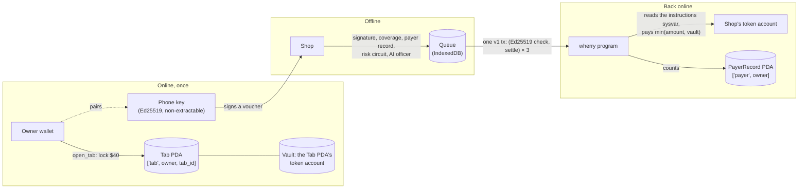

# Wherry

**The ferry for your money when the network's gone.** Offline payments on Solana, backed by money already locked in an onchain escrow.

> Built for the MLH Solana Hackathon (November 2026). Devnet only. "Test dollars" are a devnet token, not money.

## The problem
When the network drops, digital payments stop and the shop takes the loss. 2.2 billion people were offline in 2025 (ITU). On April 28, 2025, Spain and Portugal went dark and in-store card payments fell 55% (Banco de España).

Other offline Solana payment projects sign a full transaction offline and broadcast it later. That hands the shop a promise the payer can still empty before it lands. **Wherry hands the shop funded money.**

**Who it's for:** market stalls and kiosks where the signal drops every day, like Amara's coffee and phone-credit kiosk in a Nairobi market, and any shop that wants to keep selling through an outage.

## How it works
1. **Escrow (online, once).** The customer locks test dollars in a *tab*, an escrow account on Solana, and pairs their phone's key with it. The tab can't be emptied until shops have had time to settle.
2. **Voucher (offline).** The phone signs a 172-byte voucher: this tab, this shop, this amount, serial number, expiry, a random nonce. The shop checks the signature, what's left in the tab, the payer's public record and its own risk limits, all offline, in milliseconds. An on-device AI risk officer can add a "Caution".
3. **Settlement (back online).** The shop settles up to five vouchers in one transaction. The program checks every signature onchain with Solana's Ed25519 precompile and pays the shop from the escrow in about a second.



## The program (devnet)
**Program ID:** `7QcwJ8Jwj4W74Ypq58U5jgBrxwHDvxquGwic2xzPr4MM` ([Explorer](https://explorer.solana.com/address/7QcwJ8Jwj4W74Ypq58U5jgBrxwHDvxquGwic2xzPr4MM?cluster=devnet)) · Anchor 1.1.2 · source in [`anchor/programs/wherry`](anchor/programs/wherry/src)

| Account | Seeds | Holds |
|---|---|---|
| `Tab` | `["tab", owner, tab_id u64 LE]` | owner, phone key, mint, deposited, settled, shortfall, expiry, settle deadline (expiry + 24 h), a 1,024-bit bitmap of settled serials |
| Vault | the Tab PDA's associated token account for the mint | the escrowed test dollars |
| `PayerRecord` | `["payer", owner]` | tabs opened, tabs closed clean, vouchers paid, volume, shortfalls (count and amount) |
| `GameConfig` | `["game", studio]` | the studio's seed commitment, round, last revealed seed |

Tab ids run 0, 1, 2… per owner (`tab_id` must equal `tabs_opened`), so a closed tab's address can never be reused.

| Instruction | Who signs | What it does |
|---|---|---|
| `open_tab(tab_id, device_key, amount, expires_at)` | owner | creates the tab and vault, moves the deposit in, starts the payer record. Expiry at most 30 days out |
| `top_up(amount)` | owner | adds to an open tab before it expires |
| `settle(serial, amount, voucher_expires_at, nonce)` | shop | pays one voucher (details below) |
| `close_tab()` | owner | after the settle deadline: refunds what's left, closes the vault and the tab, counts a clean close if there was no shortfall |
| `commit_seed(seed_hash)` / `reveal_seed(seed, next_hash)` | game studio | commit/reveal for provably fair bonus drops |

**Voucher bytes (172), signed by the phone key:** `"WHERRY01"` ‖ program id ‖ tab ‖ merchant ‖ mint ‖ amount u64 LE ‖ serial u32 LE ‖ voucher_expires_at i64 LE ‖ nonce [u8; 16].

**`settle` requires** the instruction right before it to be the Ed25519 precompile with exactly one signature, all instruction indexes `u16::MAX` (key, signature and message inline). The key must be the tab's phone key, and the message must equal the voucher bytes rebuilt from the instruction's own arguments, with merchant = the signer. Then: serial < 1024 and not already settled, voucher expiry ≤ tab expiry, now ≤ settle deadline, amount > 0. It pays `min(amount, vault)`. Any gap becomes a recorded shortfall, not a failed transaction. A batch is several (Ed25519, settle) pairs in one transaction. Three vouchers come to 1,536 bytes, so batches use v1 transactions (4,096-byte limit, live on devnet). If a v1 batch can't go through, the shop falls back to one v0 transaction per voucher, sent in parallel.

## Real devnet transactions
| What | Signature |
|---|---|
| Deploy the program | [`2KiK68Lm…zjvXVxd`](https://explorer.solana.com/tx/2KiK68LmAH9kSKmrivJsTqA4XjNH6GmLN7wwfkCN76vdLxjZ6hU34dWXZedYXcmbNXjHBrZuxws61HRURzjvXVxd?cluster=devnet) |
| Open a $40 tab from the Owner view (1.0 s) | [`5U9crhh5…F55XbGre`](https://explorer.solana.com/tx/5U9crhh5XjXnpgRAXXyQeE5P78TKtQTpW3CcPXAauwwEQisPpu3RccinLJ5QKAbR95JbmSCzGG11dgbeF55XbGre?cluster=devnet) |
| Shop settles 3 vouchers in one v1 transaction (0.93 s, 20,000 lamports) | [`3GWbVawE…aoGsDAcJX`](https://explorer.solana.com/tx/3GWbVawE3XGxjkQ8HJyJfBT6Q2vHp3athqUoZeMNQCuDYXePbHneK1To2Y12N9zvmUzwZdnHjkAfHUVaoGsDAcJX?cluster=devnet) |
| Same, from the scripted run (v1, 66,564 compute units) | [`2BjZVw7X…cRtcPj18zX45b9`](https://explorer.solana.com/tx/2BjZVw7XWS2TsdwmS7ASSrwCZXY9bVex8nKnBeJcXsKnBamknwVYPAqDgErwEJCk2xF3dVxYF4cRtcPj18zX45b9?cluster=devnet) |
| v0 fallback: 2 vouchers, 2 parallel transactions (0.7 s) | [`5ePGD7q6…MJ4VPvB5`](https://explorer.solana.com/tx/5ePGD7q692rXgfcDNKsfQEaGUJj1dzzyXu2z1qkydTEx5RDkmAP1GPTWhkCTwSGmfoBwRGo5bgocswWyMJ4VPvB5?cluster=devnet), [`4cFQHx9M…w1qJ3wvL`](https://explorer.solana.com/tx/4cFQHx9MoiE9jYr7GE7fvA23a6hPJqx6Vmb1HuMgNo1mZVyYAoMxZ8cMVjFGoAPd4qj7uAsmw3DwvRPKw1qJ3wvL?cluster=devnet) |
| Game studio commits its seed | [`2r7CnF68…JGnf7QTt`](https://explorer.solana.com/tx/2r7CnF68pXz2RU3pqXiWnzcK8afsQwmBcdnB3XUDjYA3fg3m3AF98gMRMsenBggQSvs1M5y47M17FDpNJGnf7QTt?cluster=devnet) |
| Power-up voucher settled with a sale | [`BVMGtkkQ…g8QSeiL`](https://explorer.solana.com/tx/BVMGtkkQqApsF9GKKj242tdWe5KYfha1RLHUmZMo22eqF4rFiQKvLmZAV4utLeRfVSXfajAB9a2xCZjqg8QSeiL?cluster=devnet) |
| Studio reveals the seed and commits the next | [`2nrbnoD4…uikLULe`](https://explorer.solana.com/tx/2nrbnoD4RgKxZDFgVZfiuC8YFYZHR59YPxXaLkgvPMeTiUvhd9Lk6PjqfXB7ZypqXkxDhDi4c22E9zCk4uikLULe?cluster=devnet) |

A replayed voucher fails in simulation with `VoucherAlreadySettled`. Test-USD mint: `DQRut6HQcdzu1bpKFzYRCPYfW1u7MCHso2EVGK6tuFs`.

## Measured numbers (devnet, real runs)
| What | Number | Source |
|---|---|---|
| Back online → confirmed, 3-voucher batch | 0.8–0.93 s | Shop view, `3GWbVawE…`, `5dwbbrL6…` |
| Back online → finalized, 1 voucher | 1.0 s (status polled once a second) | Shop "Measured here" panel |
| Compute, 1 voucher (shop's token account already open) | 23,688 CU | Shop panel; v0 fallback tx `4cFQHx9M…`: 23,838 CU |
| Compute, 5 vouchers in one v1 tx | 110,940 CU (≈22,200 per voucher) | `xF5ViLRC…`, decoded with `scripts/tx-info.ts` |
| Transaction size, 5 vouchers | 2,228 bytes of 4,096 | LiteSVM test |
| Fee per voucher | 5,000 lamports per Ed25519 check, plus 5,000 per transaction (6,000 per voucher in a batch of 5) | `xF5ViLRC…`: 30,000 lamports |
| AI officer decision, offline | 1.2–1.7 s (Qwen2.5 1.5B, WebGPU, Apple M-series) | Shop verdict line |

Settlement transactions carry explicit compute-unit and loaded-data limits in their v1 message config (measured by simulation; for `xF5ViLRC…`: 120,065 CU and 543,222 bytes).

We didn't move `Tab` to a zero-copy account: at 282 bytes, deserializing it is a small share of the ~22k CU per voucher (most of it is the token transfer CPI and the Ed25519 introspection), and a new layout would make every existing devnet tab unreadable.

## The app
- **Landing** (`/`): what it is and how it works, plus the blackout numbers.
- **Try it in 60 seconds** (`/app`): Owner, then Phone, then Shop, with a "Next" link at the end of each view.
  - **Owner** connects a wallet (the only place that needs one) or uses a devnet test wallet kept in the browser, gets test dollars from the faucet, pairs the phone by QR or code, and opens, tops up or closes a tab. It also shows the settlements and the public payer record.
  - **Phone** holds a non-extractable WebCrypto Ed25519 key. It finds its tab, scans the shop's sticker, shows the shop's name and key before signing, and shows each voucher as a ferry ticket with a QR. It works offline after the first load.
  - **Shop** has a printable sticker, scans or pastes vouchers, checks them offline (signature, coverage from its last sync, the payer record), and runs the **risk circuit**: a per-customer and a total limit on what it holds unsettled, which trips visibly. It also runs the **AI risk officer**, queues vouchers in IndexedDB, shows **The Crossing** (vouchers wait on the near bank and cross when settled), and settles up to five per transaction with Explorer links and measured confirm times.
- **Play** (`/play`): Doggett's Crossing. Buy a power-up offline with a voucher; it unlocks at once. After the studio settles and reveals its seed, the bonus drop opens, with the proof.
- A service worker keeps `/app` and `/play` working offline after the first visit. The only server code is the test-dollar faucet (`/api/faucet`: fixed $50, at most 3 per address and 10 per IP per hour).

## The AI risk officer (on-device, offline, tighten-only)
The officer is a small language model, **Qwen2.5-1.5B-Instruct (q4f16), run by WebLLM on WebGPU in the browser**. It's opt-in per shop device: one download of about 1 GB, then it loads from the browser cache in under a second with no network requests, and answers in about 1–2 s.
- **Order.** It only sees vouchers the rules already accepted. Code computes the soft warning signs: past shortfalls, a large share of the tab, a first tab, a stale or missing sync, a busy tab. The model picks the main reason from a fixed list (constrained by a JSON schema), and the decision follows from that reason.
- **Tighten-only.** It can decline only when code found a warning sign. It can never accept what the rules declined. Junk, errors or an 8-second timeout mean the rules decide, and the screen says so. `finalDecision()` encodes this, and the tests cover it.
- **Why this design:** in our spike, both 0.5B and 1.5B models read the numbers back correctly but ignored written rules. Asked to decide outright, they accepted vouchers with past shortfalls. Choosing a reason from a list worked: 7 of 8 test cases decided as labelled, with no false declines. The miss was a false accept, which the shopkeeper still sees as an amber warning.
- No browser WebGPU? The shop runs on rules only, and the screen says so.

## Security notes
**What is trusted**
- *The phone key holder.* Whoever holds the paired phone can sign vouchers up to the tab's escrow. The key is a non-extractable WebCrypto Ed25519 key in that browser's IndexedDB.
- *The shop's sync freshness.* Offline, a shop judges coverage from its last copy of the tab list. The screen shows its age ("synced 12 min ago") and warns about tabs it has never seen.
- *The game studio.* It commits `sha256(seed)` before purchases and must reveal the matching seed later. It can't change the seed, but it can refuse to reveal (see the known limit below).

**Attacks and what stops them**
| Attack | What stops it |
|---|---|
| Overspend across shops: offline, the phone signs more than the tab holds | Settlement pays only from escrow, `paid = min(amount, vault)`. The late shop gets what's left and the gap goes on the payer's public record. Each shop's risk circuit caps what it holds per customer and in total, and it sees the payer record before accepting. |
| Replay a voucher | Every voucher has a serial. The tab's onchain bitmap marks it settled, and a second settle fails (`VoucherAlreadySettled`). The shop also refuses a serial it has already taken, even before syncing. |
| Cross-tab replay | The tab address is inside the signed bytes. Sequential tab ids mean a closed tab's address never comes back. |
| Change the amount or redirect to another shop | The program rebuilds the voucher bytes from the instruction with `merchant = signer` and requires them to equal what the precompile verified (`VoucherMismatch`). |
| Fake Ed25519 check (wrong key, extra signatures, data pointing at another instruction) | It must be the instruction right before, the Ed25519 program, exactly one signature, inline data, and the tab's phone key. The instructions sysvar is pinned by address and read with the `_checked` loaders. |
| Front-run the owner's close | Shops settle until the settle deadline (expiry + 24 h); the owner can close only after it. The windows never overlap. |
| Grind the game seed | The studio commits before purchases and can't overwrite a pending commitment. The player's seed is the voucher nonce, random per voucher. Neither side can choose the result after seeing the other's input. |
| Fake QR sticker pasted over the shop's | The phone shows the shop's name and short key before signing, and the shop shows its key on screen. A voucher made out to a fake key fails the real shop's check at the counter ("This voucher is for another shop"), so the swap shows up before the goods leave. |
| Faucet abuse | Devnet only, a fixed $50 per request, at most 3 per address and 10 per IP per hour (in-memory limits). |

**Known limit: an unrevealed round.** The studio sees the nonces in game vouchers when it collects them. It could then decide never to reveal that round's seed, so the player paid and gets no drop. Today game vouchers carry their round in nonce bytes 0–3, and the Play page shows how long a round has gone unrevealed ("Round 0 not revealed for 2 h"). **Next step** (needs a program upgrade): settling a game voucher requires that round's seed to be revealed first, so a studio that withholds a reveal can't collect.

**Also not done:** the faucet's limits are in memory, per server instance. The shop's key lives in its browser, so it can't yet sweep its test dollars to a wallet.

## Run it
```bash
pnpm install
pnpm test          # 23 TypeScript tests: 16 program tests on LiteSVM, 7 for the offline logic
pnpm dev           # http://localhost:3000
```
- `.env.local` needs `FAUCET_SECRET_KEY`, the test-USD mint authority as a 64-byte JSON array, for the faucet. See `.env.example`. Everything else talks to the deployed program.
- Program: `pnpm anchor-build` (Anchor 1.1.2, Solana CLI 3.1.10), then `pnpm codama:js` to regenerate the client.
- Scripted devnet run: `pnpm devnet-proof` creates the mint (once), opens a tab, settles 3 vouchers in one transaction and checks that a replay fails.
- On a real phone without publishing anything: `pnpm build && pnpm lan` serves the production build over HTTPS on your Wi-Fi address only, with a self-signed certificate. Phones need HTTPS for the camera and WebCrypto. Ctrl+C stops it.

Pinned versions and the reasons for them: [VERSIONS.md](VERSIONS.md).

## What we learned
- Three inline Ed25519 checks plus three settle instructions come to 1,536 bytes, over the legacy 1,232-byte limit. v1 transactions (4,096 bytes) are live on devnet and LiteSVM runs them, so the batch of three works today.
- Requiring `tab_id == tabs_opened` closes the cross-tab replay hole for free.
- Small on-device models read numbers well but don't apply rules. Letting the model choose a reason from a schema, and deriving the decision in code, made the officer usable without letting it loosen anything.
- `solana program deploy --use-rpc` hit public devnet rate limits for a 328 KB program; the default TPU path deployed it in 17.5 s.

## Credits and AI disclosure
- Forked from the Solana Foundation template [`kit/nextjs-anchor`](https://github.com/solana-foundation/templates/tree/main/kit/nextjs-anchor) (`npx -y create-solana-dapp@latest -t solana-foundation/templates/kit/nextjs-anchor`). We kept its Next.js, `@solana/kit`, Codama and Anchor setup and its wallet-standard connection layer (the Kit-native path, not the older `@solana/wallet-adapter`), and replaced the vault program and the demo UI.
- **Built with Claude Code** (Anthropic's Claude) as the pair programmer for the program, the tests, the app and this README, with a human owner making the calls.
- **In-product AI:** Qwen2.5-1.5B-Instruct via [WebLLM](https://github.com/mlc-ai/web-llm), running on the shop's device.
- Mascot (Doggett) and brand drawn for this project. The name comes from Doggett's Coat and Badge, the Thames watermen's race rowed since 1715.
