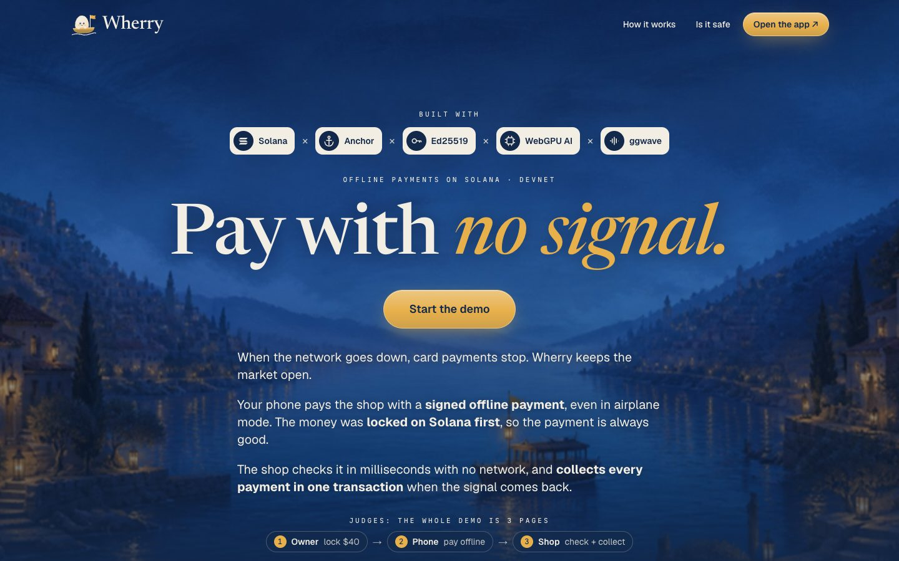
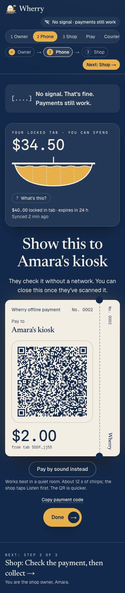
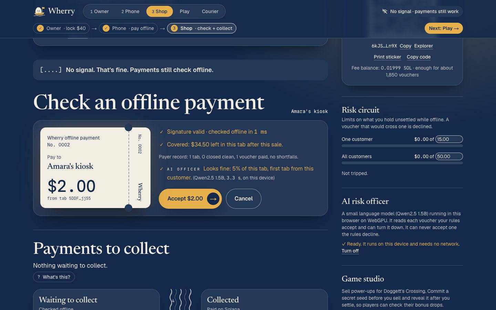
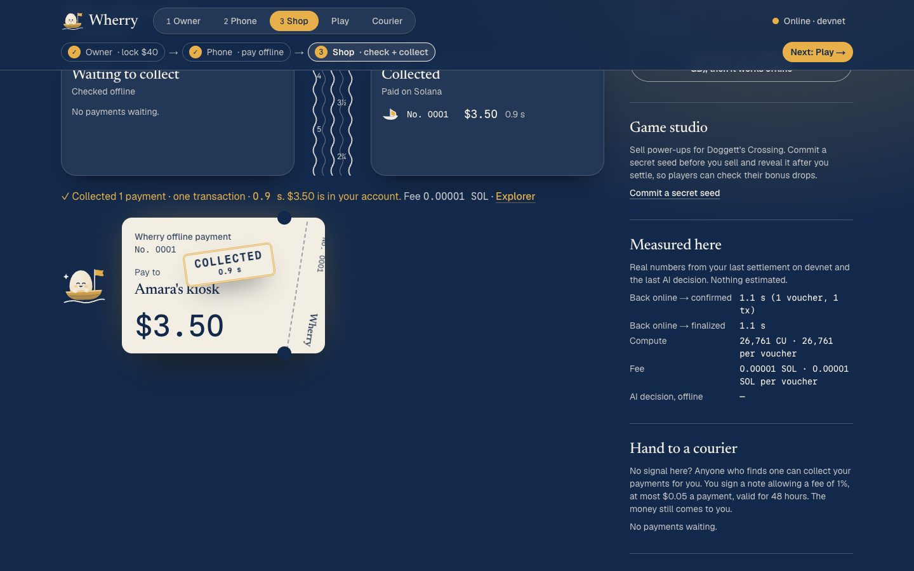
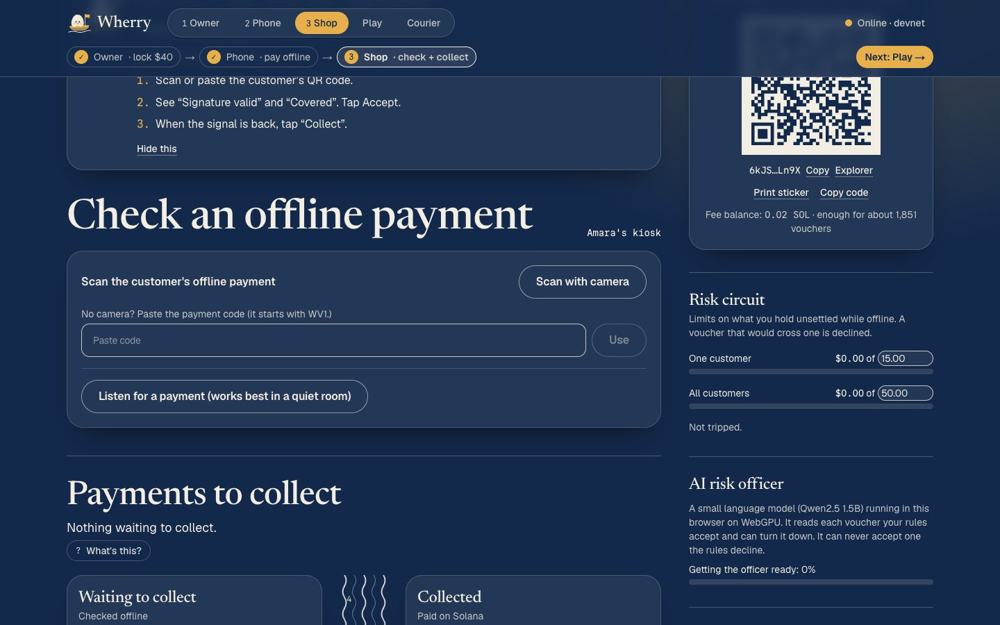
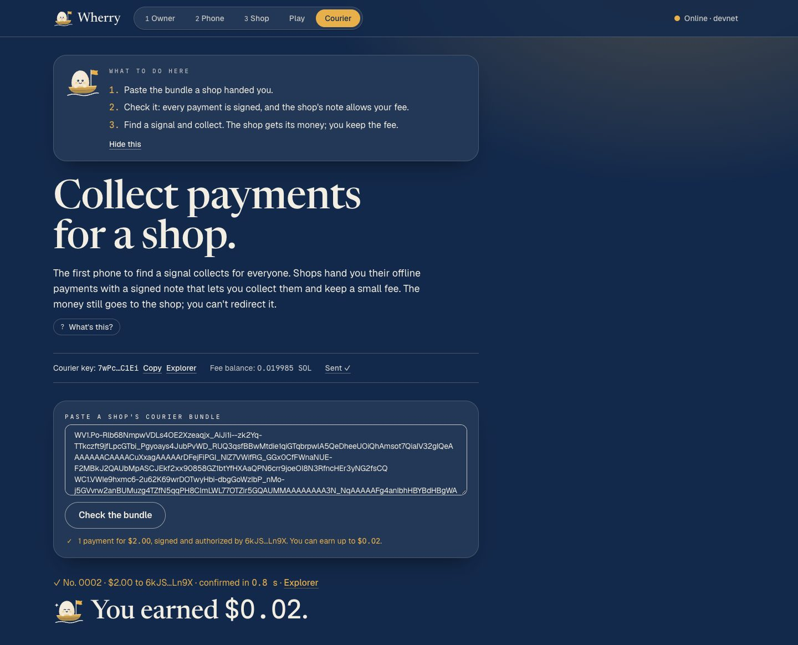
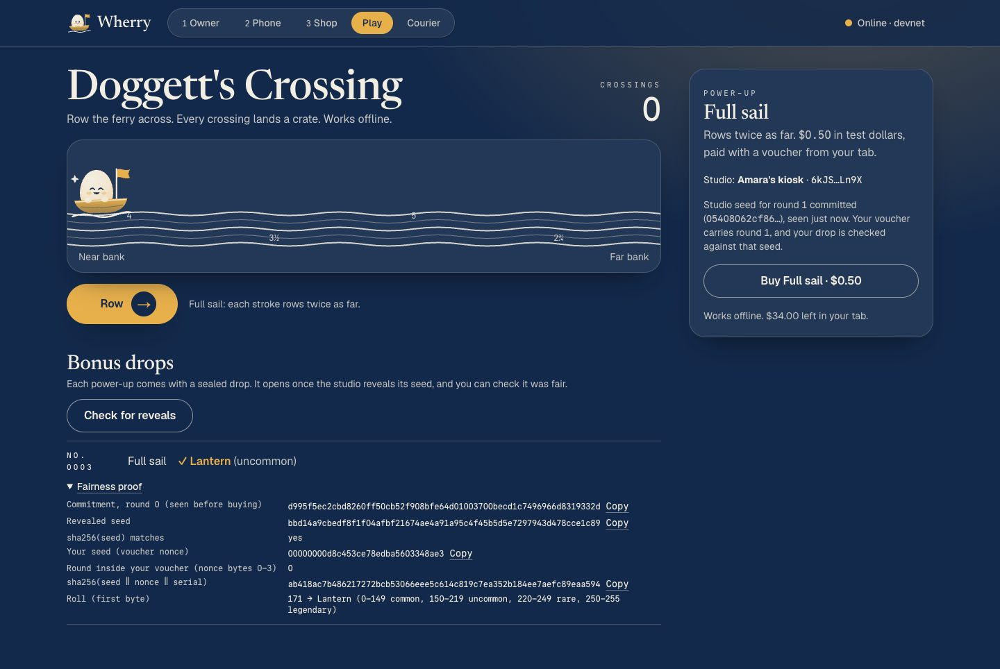
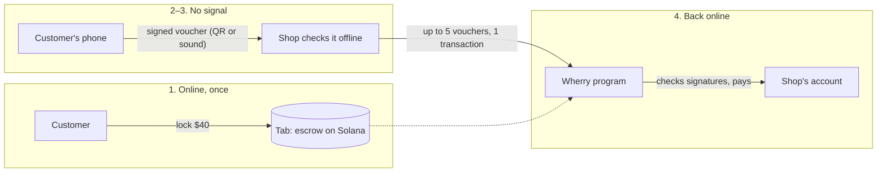
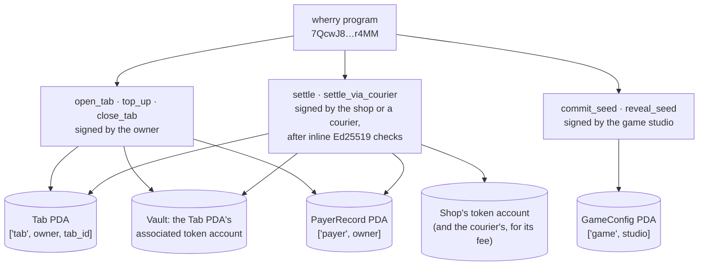

<p align="center">
  
</p>

<p align="center"><strong>The ferry for your money when the network's gone.</strong><br>
Pay offline with money that is already locked on Solana, so the shop knows it will be paid.</p>

<p align="center">
  <a href="https://wherry-pay.vercel.app"></a>
  <a href="https://explorer.solana.com/address/7QcwJ8Jwj4W74Ypq58U5jgBrxwHDvxquGwic2xzPr4MM?cluster=devnet"></a>
  
  
  
  
</p>

<p align="center">
  <a href="https://wherry-pay.vercel.app"><strong>Try the live app</strong></a> ·
  <a href="#try-it-in-2-minutes">Try it in 2 minutes</a> ·
  <a href="#how-it-works">How it works</a> ·
  <a href="#proof-it-works">Devnet proof</a> ·
  <a href="#security">Security</a>
</p>

Demo video: (link coming)

Built solo for the **MLH Solana Hackathon**, Nov 6–8, 2026. Everything runs on Solana **devnet**; "test dollars" are a devnet token, not money.

## What it does

When the network goes down, card and phone payments stop and small shops lose the sale. With Wherry, a customer locks money in an escrow account on Solana while they still have a signal. Later, with no signal at all, their phone signs small vouchers ("ferry tickets"), and the shop checks each one on the spot without a network. When the shop is back online, it collects from the escrow in about a second.

It is for places like Amara's kiosk in a Nairobi market, where the signal drops every day, and for travellers stranded when a storm takes the towers down.

| Track | What Wherry does for it |
|---|---|
| **DeFi** | Escrow-backed offline payments, up to 5 collected in one transaction, public shortfall records, shop risk limits, a consent-based courier fee |
| **AI** | Two small models running on the device with no internet: a shop risk officer that can only say no, and a budget planner for a stranded traveller |
| **Gaming** | Doggett's Crossing: buy a power-up offline, with a bonus drop anyone can check was fair (commit/reveal onchain) |
| **Why Solana** | The built-in Ed25519 signature check lets the program verify phone-signed vouchers onchain; settlement lands in about a second for a fraction of a cent |

## Why I built this

A year ago, a landslide cut off the remote area I was in. There was no network, my fuel was running low, and I had no cash. I had money in my account and couldn't spend a cent of it, because every way I knew to pay needed a signal.

I looked online for something that worked offline and found very little a shop could actually trust. Later I learned how common this is: 2.2 billion people are still offline ([ITU, 2025](https://www.itu.int/en/mediacentre/Pages/PR-2025-11-17-Facts-and-Figures.aspx)), and when the power went out across Spain and Portugal in April 2025, in-store card payments fell 55% ([Banco de España](https://www.bde.es/wbe/es/noticias-eventos/blog/como-pagamos-cuando-todo-se-apaga-la-experiencia-del-apagon-en-espana.html)).

Wherry is what I wish I'd had that day. I don't want anyone else to be stuck the way I was.

## Try it in 2 minutes

1. **Window A:** open https://wherry-pay.vercel.app/app, go to **Owner**, click "No wallet? Use a test wallet in this browser (devnet only)", then **Get $50 test dollars**.
2. **Window B:** open https://wherry-pay.vercel.app/app/phone and click **Copy code** under "Pair this phone".
3. **Window A:** paste the code under "Pair your phone", enter 40, click **Lock $40.00 in a tab**, and wait for "Confirmed in … s".
4. **Window A:** go to **Shop** and click **Copy code** under the shop's sticker.
5. **Window B:** click **Refresh** until your tab shows, then turn off Wi-Fi. Paste the shop code, enter 3, click **Sign a $3.00 payment to Amara's kiosk**, then **Copy payment code**.
6. **Window A (Shop):** paste the payment code ("Signature valid · checked offline in <1 ms"), click **Accept $3.00**, turn Wi-Fi back on, and click **Collect $3.00**.

Paste the same code again and the shop declines it.

## Screenshots

All taken on the live site on November 8, 2026, with real devnet transactions.


*The landing page: what Wherry does and the 3-step demo path, so a judge can start in one click.*


*The phone in airplane mode signing a $2.00 payment as a QR code: paying needs no network at all.*


*The shop checking a payment with no network: signature valid in 1 ms, covered by the locked tab ($34.50 left), and the on-device AI officer's verdict in 3.3 s.*


*Back online, the shop collects: confirmed on Solana in 0.9 s, with the Explorer link and the real compute and fee numbers.*


*The shop's "Listen for a payment" button next to its risk limits: a second offline channel when the camera can't read a QR.*


*A courier with a signal collects a shop's $2.00 payment in 0.8 s and keeps $0.02, the fee the shop's signed note allows; the money still goes to the shop.*


*Play: a power-up bought offline, and the proof that its bonus drop came from a seed committed before the sale.*

## How it works

1. **Lock a tab (online, once).** The customer locks, say, $40 in a *tab*: an escrow account owned by the Wherry program, tied to a key that lives only on their phone.
2. **The phone signs a voucher (offline).** To pay $3, it signs a 172-byte voucher naming this tab, this shop, this amount and a serial number, and shows it as a QR code (or plays it as sound).
3. **The shop checks it (offline):** the signature (under 1 ms), what is left in the tab at its last sync, the customer's public payer record and its own risk limits. An on-device AI model can add a "no".
4. **The shop collects (back online).** It sends up to five vouchers in one transaction. The program re-checks every signature and pays the shop from the escrow.



## Under the hood

**Program ID:** `7QcwJ8Jwj4W74Ypq58U5jgBrxwHDvxquGwic2xzPr4MM` ([Explorer](https://explorer.solana.com/address/7QcwJ8Jwj4W74Ypq58U5jgBrxwHDvxquGwic2xzPr4MM?cluster=devnet)) · Anchor 1.1.2 · source in [`anchor/programs/wherry`](anchor/programs/wherry/src) · test-USD mint `DQRut6HQcdzu1bpKFzYRCPYfW1u7MCHso2EVGK6tuFs`



A `Tab` holds the owner, phone key, mint, amounts deposited and settled, shortfall, expiry, settle deadline (expiry + 24 h) and a 1,024-bit bitmap of settled serials. Its vault is the Tab PDA's associated token account.

| Instruction | Signed by | What it does |
|---|---|---|
| `open_tab` | owner | creates the tab and vault, moves the deposit in; expiry at most 30 days out |
| `top_up` | owner | adds to an open tab |
| `settle` | shop | pays one voucher |
| `settle_via_courier` | anyone | pays one voucher to the shop with its signed consent; the courier keeps a capped fee |
| `close_tab` | owner | after the settle deadline, refunds the rest |
| `commit_seed` / `reveal_seed` | game studio | commit and reveal for fair drops |

**Voucher (172 bytes, signed by the phone key):** `"WHERRY01"` ‖ program id ‖ tab ‖ merchant ‖ mint ‖ amount u64 LE ‖ serial u32 LE ‖ voucher_expires_at i64 LE ‖ nonce [u8; 16]

`settle` checks that the instruction before it verified this voucher (rebuilt from its own arguments, merchant = signer) with the tab's phone key, then: serial < 1024 and unused, voucher expiry ≤ tab expiry, now ≤ settle deadline, amount > 0. It pays `min(amount, vault)`.

**Courier note (138 bytes, signed by the shop):** `"WHERRYC1"` ‖ program id ‖ merchant ‖ tab ‖ max_fee_bps u16 ‖ max_fee_abs u64 ‖ auth_expires_at i64 ‖ auth_nonce [u8; 16]. `settle_via_courier` needs two Ed25519 checks before it. The fee is `min(paid × fee_bps / 10,000, max_fee_abs)`, taken from what was paid.

**Transactions.** Each voucher needs a 284-byte Ed25519 instruction, so three pass the old 1,232-byte limit. Batches use **v1 transactions** (five vouchers take 2,228 of 4,096 bytes), with a fallback to parallel **v0** transactions, one per voucher.

## Proof it works

| What | Signature |
|---|---|
| Deploy the program | [`2KiK68Lm…zjvXVxd`](https://explorer.solana.com/tx/2KiK68LmAH9kSKmrivJsTqA4XjNH6GmLN7wwfkCN76vdLxjZ6hU34dWXZedYXcmbNXjHBrZuxws61HRURzjvXVxd?cluster=devnet) |
| Open a $40 tab from the Owner view (1.0 s) | [`5U9crhh5…F55XbGre`](https://explorer.solana.com/tx/5U9crhh5XjXnpgRAXXyQeE5P78TKtQTpW3CcPXAauwwEQisPpu3RccinLJ5QKAbR95JbmSCzGG11dgbeF55XbGre?cluster=devnet) |
| Shop settles 3 vouchers in one v1 transaction (0.93 s) | [`3GWbVawE…aoGsDAcJX`](https://explorer.solana.com/tx/3GWbVawE3XGxjkQ8HJyJfBT6Q2vHp3athqUoZeMNQCuDYXePbHneK1To2Y12N9zvmUzwZdnHjkAfHUVaoGsDAcJX?cluster=devnet) |
| 5 vouchers in one v1 transaction (0.8 s, 110,940 CU) | [`xF5ViLRC…1CMvfwTC`](https://explorer.solana.com/tx/xF5ViLRC44dCNDgD798kTTqWxB3gL7cq5QqkjwjUC5CNRBEmMicXhZtKmshepG8nkCNHtahrR7GirNR1CMvfwTC?cluster=devnet) |
| v0 fallback: 2 vouchers, 2 parallel transactions (0.7 s) | [`5ePGD7q6…MJ4VPvB5`](https://explorer.solana.com/tx/5ePGD7q692rXgfcDNKsfQEaGUJj1dzzyXu2z1qkydTEx5RDkmAP1GPTWhkCTwSGmfoBwRGo5bgocswWyMJ4VPvB5?cluster=devnet), [`4cFQHx9M…w1qJ3wvL`](https://explorer.solana.com/tx/4cFQHx9MoiE9jYr7GE7fvA23a6hPJqx6Vmb1HuMgNo1mZVyYAoMxZ8cMVjFGoAPd4qj7uAsmw3DwvRPKw1qJ3wvL?cluster=devnet) |
| Game studio commits its seed | [`2r7CnF68…JGnf7QTt`](https://explorer.solana.com/tx/2r7CnF68pXz2RU3pqXiWnzcK8afsQwmBcdnB3XUDjYA3fg3m3AF98gMRMsenBggQSvs1M5y47M17FDpNJGnf7QTt?cluster=devnet) |
| Power-up voucher settled with a sale | [`BVMGtkkQ…g8QSeiL`](https://explorer.solana.com/tx/BVMGtkkQqApsF9GKKj242tdWe5KYfha1RLHUmZMo22eqF4rFiQKvLmZAV4utLeRfVSXfajAB9a2xCZjqg8QSeiL?cluster=devnet) |
| Studio reveals the seed and commits the next | [`2nrbnoD4…uikLULe`](https://explorer.solana.com/tx/2nrbnoD4RgKxZDFgVZfiuC8YFYZHR59YPxXaLkgvPMeTiUvhd9Lk6PjqfXB7ZypqXkxDhDi4c22E9zCk4uikLULe?cluster=devnet) |
| Program upgrade adding the courier | [`2D55e11N…zMvHYtN`](https://explorer.solana.com/tx/2D55e11NCiTcw75HkYpjjASUQRUvXR1CafGLzSuQoKZuGuu4cos5KQeYLze5iNVLLcAbmoHk4Mo3Xc4aLzMvHYtN?cluster=devnet) |
| Old flow after the upgrade: settle (0.9 s) | [`2bQZpqp8…YJcoDpxWJR`](https://explorer.solana.com/tx/2bQZpqp8PjpivrmMopiweRAo7LpDanEYjwHuiG9jZxhd3nQDzsVEyPz9yXtBFyyWioany8YS4z84tYYJcoDpxWJR?cluster=devnet) |
| Courier settles a $3.00 voucher and earns $0.03 (0.8 s) | [`45frTaVC…H27s5A5N`](https://explorer.solana.com/tx/45frTaVCUpKMwJfzrasuw8oNCdY6nXDd9dhhwJcqdG4KNg7JZiwEUjBP5PQWS3TDDsUBoWnBcMWKYfxHH27s5A5N?cluster=devnet) |
| Final build smoke test: open a $5 tab (0.8 s) | [`2itEoTek…NSWFsCa`](https://explorer.solana.com/tx/2itEoTek65pLbkDRAKxrn3xx5D2gVTwpdKH63LF6ThEcQosdpDGJ4kvUduAwTpyqNR6MBvHcLx1R7M31iNSWFsCa?cluster=devnet) |
| Final build smoke test: shop collects a $1.00 voucher (0.8 s, 25,261 CU) | [`4ZerZGrG…jessTvym`](https://explorer.solana.com/tx/4ZerZGrGE96QsePQdRvtqBogMy84ov4br3J2gFbG3fx4cT4vCEjrgrdKodzPAeuxYym5RubmpkcyuhrZjessTvym?cluster=devnet) |

A replayed voucher fails with `VoucherAlreadySettled`; I checked this on devnet after the first deploy and again after the upgrade.

| Measured on devnet | Number |
|---|---|
| Back online → confirmed (3-voucher batch) / finalized (1 voucher) | 0.8–0.93 s / 1.0 s |
| Compute | about 25,000–28,000 CU per voucher alone on the current program (23,688 before the courier upgrade); about 22,200 each in a batch of 5 before the upgrade |
| Fee | 5,000 lamports per signature check plus 5,000 per transaction: 6,000 lamports each in a batch of 5 |
| Signature check at the shop, offline | under 1 ms |
| AI risk officer decision, offline | 1.2–1.7 s (Qwen2.5 1.5B on WebGPU, Apple M-series laptop) |
| Budget planner, offline | 1.2–1.3 s per plan |

## Features beyond payments

- **AI risk officer (shop, offline).** Qwen2.5-1.5B in the browser (WebLLM, WebGPU), opt-in, about 1 GB downloaded once. Code lists the warning signs; the model picks the main reason from a fixed list, because in my tests it ignored free-text rules. That got 7 of 8 cases right with no false declines. It can only tighten.
- **Budget planner (phone, offline, advice only).** The same model splits a stranded traveller's money across water, food, transport and phone credit, and warns when a payment eats a day's food money. Code does the arithmetic.
- **Doggett's Crossing.** A power-up bought offline unlocks at once. The studio commits a seed hash before selling and reveals the seed after, so players can check the bonus drop wasn't picked later.
- **Courier.** The first device with a signal settles everyone's vouchers. The shop signs a note (1%, at most $0.05 a voucher, valid 48 hours); anyone pastes the bundle into the Courier view, and the money still lands with the shop.
- **Pay by sound.** The phone plays its voucher as [ggwave](https://github.com/ggerganov/ggwave) chirps (about 12 s) and the shop's mic decodes it; QR stays the default. Fed the phone's exact sound, the decoder got 10 of 10, 5 with added noise. I haven't tested it through the air yet.

## Run it locally

```bash
pnpm install
pnpm anchor-build   # builds the program; the tests load it
pnpm test           # 38 tests, the program ones on LiteSVM
pnpm dev            # http://localhost:3000
```

- The faucet needs `FAUCET_SECRET_KEY` in `.env.local` (the test-USD mint authority as a 64-byte JSON array; see `.env.example`). Everything else talks to the deployed program.
- `pnpm codama:js` regenerates the client after a program change.
- `pnpm devnet-proof` opens a tab, settles 3 vouchers in one transaction and checks that a replay fails.
- `pnpm build && pnpm lan` serves the build over HTTPS on your Wi-Fi address only, for testing on a real phone (phones need HTTPS for the camera and the signing key).

Versions: Node 26.8.1, pnpm 12.8.1, Solana CLI 3.1.10, Anchor 1.1.2, Rust 1.98.1, Next.js 16.4.3, React 19.2.3, @solana/kit 8.6.0, LiteSVM 1.6.2. [VERSIONS.md](VERSIONS.md) says why each one.

## Tests

**38/38 pass** (`pnpm anchor-build && pnpm test`, on main, Nov 8, 2026). They cover every rejection path in the program on LiteSVM, seeded property tests over 25 random worlds (no overpay, no double pay, vault + shop + courier = deposit), and the offline logic: codes, risk limits, the AI tighten-only rule and the sound encoding.

## Security

**Trusted:** whoever holds the paired phone (up to what is in the tab; the key can't be exported, and a test checks that), the shop's last sync (its age is on screen), and the game studio, to reveal its seed.

| Attack | What stops it |
|---|---|
| Overspend across shops while offline | The program pays `min(amount, what's left)` and records the gap publicly; shop risk limits cap the exposure. |
| Replay a voucher | Each serial flips a bit in the tab; the shop also refuses one it already took. |
| Replay on another tab | The tab address is in the signed bytes, and tab addresses are never reused. |
| Change the amount or the shop | The program rebuilds the voucher from its arguments and requires an exact match. |
| Fake signature check | Must be the real Ed25519 program, right before, one inline signature by the tab's phone key; the sysvar is pinned by address. |
| Close the tab before shops collect | Shops can settle until expiry + 24 h; the owner can close only after that. |
| Fake QR sticker over the shop's | The phone shows the shop's name and key; a voucher to a fake key fails the real shop's check. |
| Stolen phone | At most what is left in the tab; the key can't be copied off. |
| Tampered app signing two "next" vouchers | Vouchers link to the previous one; a shop declines the fork and keeps both as proof. |
| Courier redirecting money or raising its fee | The voucher fixes the shop; the shop's note fixes the tab, fee caps and expiry. |
| Faucet abuse | Devnet only, $50 per request, at most 3 per address and 10 per IP per hour. |

## Limits and what's next

- **Devnet only, test dollars only.** Amara's kiosk is a demo shop; there has been no pilot with a real kiosk yet.
- **Unrevealed game rounds.** The studio could withhold a seed; the Play page shows how long a round has gone unrevealed. Fix: settle game vouchers only after the reveal.
- **Keys live in the browser.** Next: the phone's secure element, checked with Solana's secp256r1 precompile.
- **Coverage is only as fresh as the last sync.** Risk limits bound the loss from old data; they don't remove it.
- **Faucet limits are in memory**, per server instance.
- **Not yet tested** over the air for pay by sound, with a real wallet extension, or in airplane mode on two real phones.

With a microgrant, I would run a pilot with a few market kiosks, move the phone key into the secure element, get the program audited, and switch from the test token to a real stablecoin on mainnet.

## Methodology

Other offline payment projects on Solana sign a whole transaction on the phone and broadcast it later; until it lands, the payer can still empty the account, so the shop holds a promise. I built Wherry around closing that gap: the money is locked first, and only a tiny authorisation travels offline. I tested it with 38 TypeScript tests against the real program in LiteSVM, then ran each milestone on devnet from the real UI and recorded the signatures above.

I picked this problem after ranking ten money problems by how many people they hit, how much one-second, sub-cent settlement changes the outcome, and whether I could show it working in two minutes.

| Decision | Why |
|---|---|
| Vouchers backed by an escrow tab | The money exists before the sale. |
| Ed25519 precompile + instructions sysvar | Cheap native signature checks that the program can inspect onchain. |
| Sequential tab ids | A closed tab's address never comes back, so an old voucher can't be replayed on a new tab. |
| A 1,024-bit bitmap per tab | Replay protection for 128 bytes per tab and no extra accounts. |
| Shortfall instead of failure | The late shop still gets what is left; a failed transaction pays nothing. |
| Shop risk limits | Each shop's worst case is a number it chose. |
| AI that can only tighten | The model can turn an accept into a decline, never the reverse; if it fails or times out, the rules decide. |
| Courier fee only with the shop's consent | Anyone may settle, but the fee is capped and expires by the shop's own signature. |
| No zero-copy account | A 282-byte tab costs little compute, and a new layout would break existing devnet tabs. |
| No onchain hash chain | It would force vouchers from different shops to settle in order; shops catch forks offline. |

## Built with

- The Solana Foundation template [`kit/nextjs-anchor`](https://github.com/solana-foundation/templates/tree/main/kit/nextjs-anchor): I kept its Next.js, `@solana/kit`, Codama, Anchor and wallet-standard setup and replaced the program and the UI.
- Anchor, @solana/kit, Codama, LiteSVM, Next.js, Tailwind CSS; [WebLLM](https://github.com/mlc-ai/web-llm) with Qwen2.5-1.5B-Instruct; [ggwave](https://github.com/ggerganov/ggwave); uqr and jsQR; idb-keyval.
- The brand and Doggett were drawn for this project. Doggett is named after Doggett's Coat and Badge, a race Thames watermen have rowed since 1715.

## AI tools I used

- **Claude Code** (Anthropic) to research the problem and prior work and to write the program, the tests, the app and this README with me. I made the calls on what to build and what to cut.
- **Qwen2.5-1.5B-Instruct via WebLLM** runs inside the product, on the shop's and the phone's own devices.

## Licence

MIT. See [LICENSE](LICENSE). Copyright (c) 2026 Hotragn Pettugani.
